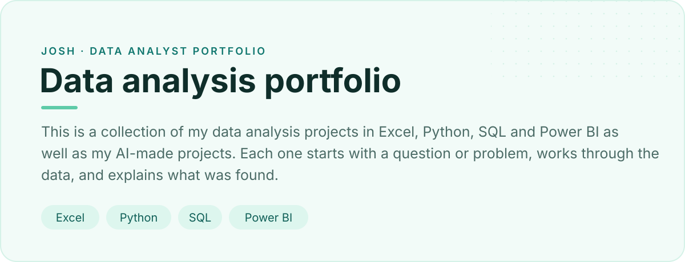
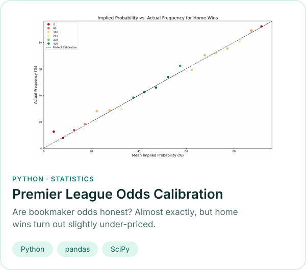
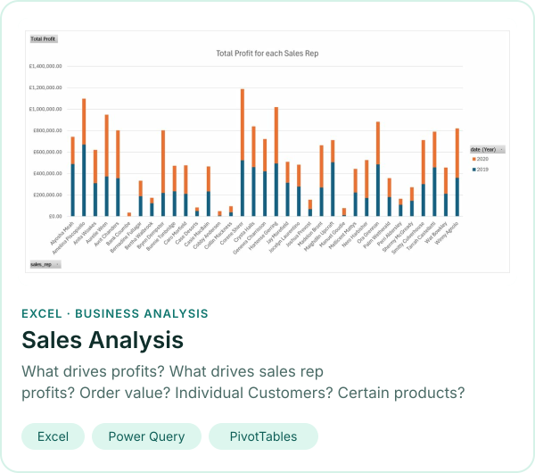
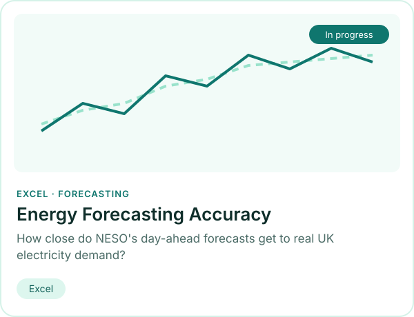
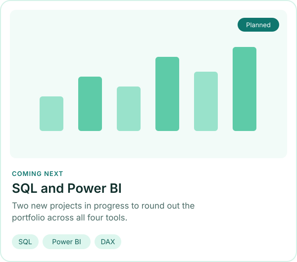

  

 

  
  

  
  

 

Larger systems I directed and reviewed, with the code written mostly by Claude.

| Project | What it does | Stack |
|---|---|---|
| [pl-betting-system](https://github.com/Joshc386/pl-betting-system) | Prices football goals markets with a model ensemble and Kelly staking | Python · LightGBM · SQLite |
| [wc-bet-system](https://github.com/Joshc386/wc-bet-system) | Simulates the 2026 World Cup from Elo ratings, backtested on nine tournaments | Python · Monte Carlo |
| [BetStatsInterface](https://github.com/Joshc386/BetStatsInterface) | Football statistics platform with scheduled data collection | PostgreSQL · FastAPI · React |
| [polymarket-momentum-sniper](https://github.com/Joshc386/polymarket-momentum-sniper) | Paper-trading bot with risk controls and out-of-sample backtests | Python |
